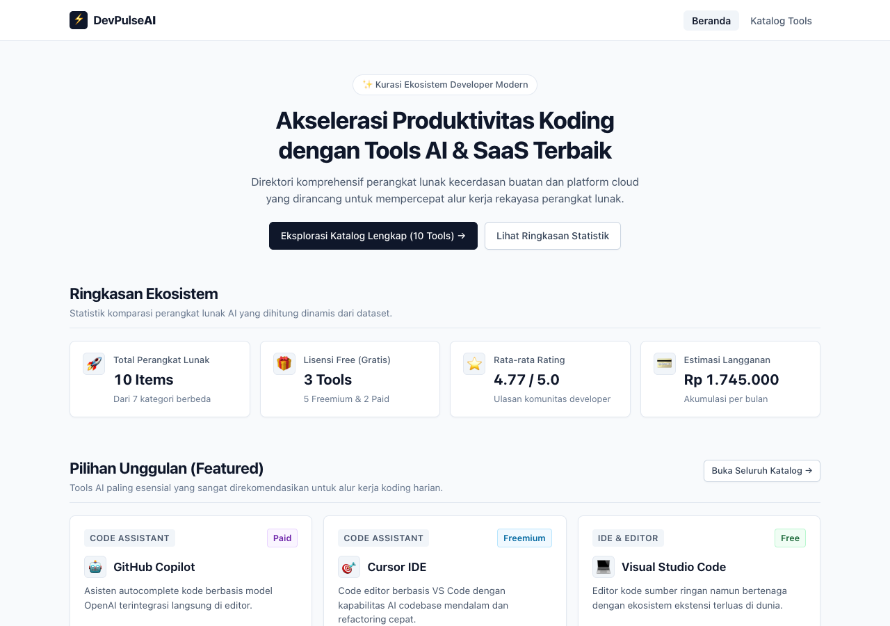
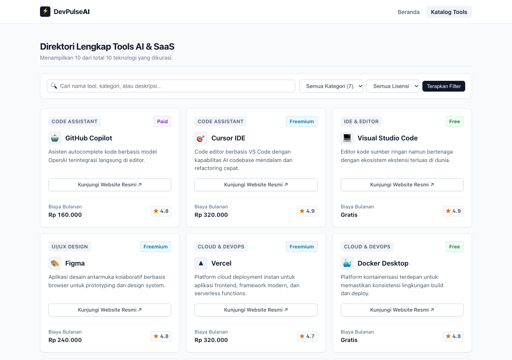

# DevPulse AI - Direktori Tools AI & SaaS Developer

> **Dokumentasi Proyek Ujian Tengah Semester (UTS) Pemrograman Web**  
> Repositori GitHub: [https://github.com/LilAlamin/uts-pemweb-025A00232002](https://github.com/LilAlamin/uts-pemweb-025A00232002)

---

## 1. Identitas Mahasiswa
- **Nama Lengkap**: Ronald Ramadhani Pangestu
- **NIM**: 025A00232002
- **Kelas / Semester**: Teknik Informatika / Semester 3
- **Mata Kuliah**: Pemrograman Web

---

## 2. Deskripsi Singkat Tema
DevPulse AI adalah aplikasi web direktori dan kurasi perangkat lunak kecerdasan buatan (*Artificial Intelligence*) serta platform SaaS yang dirancang untuk membantu mahasiswa dan *software engineer* memilih alat pengembangan terbaik. Aplikasi ini menyajikan data perbandingan model lisensi (*Free, Freemium, Paid*), estimasi biaya langganan, dan ulasan rating secara transparan melalui antarmuka modern berbasis PHP Native 8.x dan Vanilla CSS. Melalui fitur pencarian teks interaktif dan filter kategori dinamis, pengguna dapat menemukan teknologi yang paling tepat sesuai kebutuhan tugas kuliah maupun proyek produksi.

---

## 3. Cara Menjalankan di Localhost

### Prasyarat:
- Komputer telah terpasang **PHP versi 8.1** atau yang lebih baru (verifikasi dengan perintah `php -v`).

### Langkah-langkah:
1. **Clone Repositori**:
   ```bash
   git clone https://github.com/LilAlamin/uts-pemweb-025A00232002.git
   ```
2. **Masuk ke Direktori Proyek**:
   ```bash
   cd uts-pemweb-025A00232002
   ```
3. **Jalankan Web Server Bawaan PHP**:
   ```bash
   php -S localhost:8000
   ```
4. **Buka di Peramban (Web Browser)**:
   - Halaman Beranda: [http://localhost:8000/index.php](http://localhost:8000/index.php)
   - Halaman Katalog: [http://localhost:8000/katalog.php](http://localhost:8000/katalog.php)

---

## 4. Daftar Fitur, Berkas, dan Fungsi Penangan

Berikut adalah pemetaan seluruh fitur fungsional aplikasi beserta file dan nama fungsi PHP yang menanganinya:

| No | Fitur Aplikasi | Berkas Terkait | Nama Fungsi / Komponen | Keterangan Singkat |
| :-: | :--- | :--- | :--- | :--- |
| 1 | **Sanitasi Keamanan Output (XSS Prevention)** | `functions.php` | `bersihkan()` *(alias `e()`)* | Membungkus pencetakan string ke HTML dengan `htmlspecialchars` agar terhindar dari serangan Cross-Site Scripting. |
| 2 | **Format Mata Uang Rupiah** | `functions.php` | `formatRupiah()` | Mengonversi integer biaya langganan bulanan ke format `Rp xx.xxx` atau `Gratis` jika bernilai 0. |
| 3 | **Styling Dinamis Badge Lisensi** | `functions.php` | `warnaBadge()` | Menentukan class warna badge lisensi (*Free, Freemium, Paid*) menggunakan ekspresi PHP 8 `match`. |
| 4 | **Predikat Kualitatif Rating** | `functions.php` | `predikatRating()` | Menghasilkan label predikat ulasan (*Sangat Direkomendasikan, Unggul & Populer, dll.*) berbasis `match`. |
| 5 | **Kalkulasi Metrik Statistik** | `functions.php` | `hitungStatistik()` | Menghitung total data, jumlah lisensi, rata-rata rating, akumulasi biaya, dan daftar kategori unik. |
| 6 | **Penyaringan & Pencarian Data** | `functions.php` | `filterTools()` | Menyaring array data tools berdasarkan kategori, lisensi, dan kata kunci teks secara *case-insensitive*. |
| 7 | **Kurasi Perangkat Unggulan** | `functions.php` | `ambilUnggulan()` | Menyaring dan mengambil 3 tools pilihan teratas dengan flag `is_featured = true` untuk beranda. |
| 8 | **Halaman Beranda & Metrik** | `index.php` | View Controller Script | Merender *hero section*, 4 kartu metrik statistik dinamis, 3 kartu unggulan, dan info panduan lisensi. |
| 9 | **Katalog & Filter Interaktif** | `katalog.php` | View Controller Script | Menangani form filter GET, merender grid 10 kartu tools, serta menampilkan pesan *empty state*. |
| 10 | **Dataset Array Multidimensi** | `data.php` | `$tools` | Sumber data array multidimensi 10 tools $\times$ 9 atribut data lengkap. |

---

## 5. Daftar Fungsi Array Bawaan yang Dipakai dan Fungsinya

Aplikasi ini memanfaatkan fungsi-fungsi bawaan PHP (*built-in array functions*) untuk pengolahan data array multidimensi secara efisien:

1. **`count()`**  
   - **Lokasi Berkas**: `functions.php` (fungsi `hitungStatistik()`), `index.php`, dan `katalog.php`.  
   - **Fungsi**: Menghitung total keseluruhan elemen data tools, menghitung jumlah perangkat pada tiap model lisensi (*free*, *freemium*, *paid*), serta menampilkan jumlah data hasil filter pencarian.

2. **`array_filter()`**  
   - **Lokasi Berkas**: `functions.php` (fungsi `hitungStatistik()`, `filterTools()`, dan `ambilUnggulan()`).  
   - **Fungsi**: Menyaring item array berdasarkan kondisi tertentu via fungsi *callback* (mengelompokkan lisensi, mencocokkan kata kunci pencarian pada nama/deskripsi/kategori, serta menyaring item berstatus *featured*).

3. **`array_column()`**  
   - **Lokasi Berkas**: `functions.php` (fungsi `hitungStatistik()`).  
   - **Fungsi**: Mengekstrak seluruh nilai dari satu kunci spesifik pada array multidimensi (seperti kolom `biaya_bulanan`, `rating`, dan `kategori`) menjadi array satu dimensi.

4. **`array_sum()`**  
   - **Lokasi Berkas**: `functions.php` (fungsi `hitungStatistik()`).  
   - **Fungsi**: Menjumlahkan seluruh angka pada array kolom `biaya_bulanan` untuk menghitung total biaya langganan per bulan, serta menjumlahkan nilai `rating` untuk kalkulasi nilai rata-rata.

5. **`array_unique()`**  
   - **Lokasi Berkas**: `functions.php` (fungsi `hitungStatistik()`).  
   - **Fungsi**: Menghilangkan nilai duplikat pada array kategori sehingga menghasilkan daftar kategori unik yang digunakan untuk mengisi opsi dropdown filter di `katalog.php`.

6. **`array_values()`**  
   - **Lokasi Berkas**: `functions.php` (fungsi `hitungStatistik()` dan `ambilUnggulan()`).  
   - **Fungsi**: Mengindeks ulang kunci numerik array agar kembali berurutan dari 0 setelah elemen-elemennya disaring atau dihilangkan nilai duplikatnya.

7. **`array_slice()`**  
   - **Lokasi Berkas**: `functions.php` (fungsi `ambilUnggulan()`).  
   - **Fungsi**: Memotong dan mengambil 3 elemen teratas dari array perangkat unggulan untuk ditampilkan secara ringkas di halaman beranda.

8. **`sort()`**  
   - **Lokasi Berkas**: `functions.php` (fungsi `hitungStatistik()`).  
   - **Fungsi**: Mengurutkan daftar kategori unik secara alfabetis (A-Z) agar opsi pada dropdown filter tersusun rapi.

---

## 6. Tangkapan Layar Aplikasi (Screenshots)

Berikut adalah bukti tangkapan layar antarmuka aplikasi **DevPulse AI** yang telah dibangun:

### Tangkapan Layar 1: Halaman Beranda (`index.php`)
Menampilkan navigasi utama, *hero section*, 4 metrik kartu statistik yang dihitung dinamis dari array, kurasi kartu *Featured Tools*, dan panduan lisensi:



### Tangkapan Layar 2: Halaman Katalog Lengkap (`katalog.php`)
Menampilkan input pencarian teks *real-time*, dropdown filter kategori dinamis, filter model lisensi, serta kartu direktori perangkat lunak:



---

## 7. Sumber Referensi dan Catatan Pemakaian AI

### Sumber Referensi:
1. **PHP Official Documentation**: [https://www.php.net/manual/en/](https://www.php.net/manual/en/) (Referensi sintaks `declare(strict_types=1)`, `match expression`, dan fungsi bawaan manipulasi array).
2. **MDN Web Docs**: [https://developer.mozilla.org/](https://developer.mozilla.org/) (Standar HTML5 Semantic Elements, CSS Flexbox, dan CSS Grid).
3. **PHP-FIG PSR-12 Coding Style Guide**: [https://www.php-fig.org/psr/psr-12/](https://www.php-fig.org/psr/psr-12/) (Standar penulisan kode bersih, indentasi, dan penamaan fungsi).
4. **Website Resmi Tools yang Dikurasi**: GitHub Copilot, Cursor IDE, Visual Studio Code, Figma, Vercel, Docker Desktop, Postman, Notion, n8n, dan Claude AI.

### Catatan Pemakaian AI:
- **Alat Bantu yang Digunakan**: Google Gemini / Antigravity AI Assistant.
- **Tujuan Pemanfaatan**:
  - Membantu *brainstorming* arsitektur pemisahan berkas (*Separation of Concerns*) dan penataan struktur fungsi PHP 8 bertipe ketat.
  - Membantu audit estetika antarmuka CSS manual agar bersih dan rapi (*clean design*), memperbaiki rasio kontras warna sesuai standar aksesibilitas WCAG AA, serta menyusun format dokumentasi teknis.
- **Kemandirian dan Orisinalitas**: Seluruh implementasi logika PHP, struktur data array multidimensi 10 tools, sanitasi XSS, pengujian kode di localhost, penyesuaian gaya CSS manual, dan alur komit Git dipahami, diverifikasi, dan dijalankan secara mandiri oleh mahasiswa sesuai ketentuan penugasan UTS.

---

## 🎯 Lampiran: Panduan Jawaban Modifikasi Saat Demo Dosen

Dosen penguji kerap menguji pemahaman mahasiswa dengan meminta perubahan kode secara langsung di tempat. Berikut panduan jawaban cepat:

### Skenario 1: *"Coba tambahkan 1 tool baru ke dalam katalog."*
- **Lokasi file**: Buka berkas [`data.php`](data.php).
- **Aksi**: Tambahkan entitas baru ke-11 di akhir array:
  ```php
  [
      'id' => 11,
      'nama_tool' => 'DeepSeek Coder',
      'kategori' => 'Code Assistant',
      'model_lisensi' => 'Free',
      'biaya_bulanan' => 0,
      'rating' => 4.8,
      'deskripsi_singkat' => 'Model AI penalaran kode sumber terbuka dengan performa tinggi.',
      'website_resmi' => 'https://deepseek.com',
      'icon_symbol' => '🐋',
      'is_featured' => false,
  ],
  ```
- **Hasil**: Halaman beranda dan katalog otomatis mengupdate total menjadi 11 items, menghitung ulang rating, dan menambah kategori jika ada yang baru secara dinamis!

### Skenario 2: *"Bagaimana jika ada diskon 20% untuk semua tools berbayar?"*
- **Lokasi file**: Buka berkas [`functions.php`](functions.php) pada fungsi `formatRupiah()`.
- **Aksi**: Cukup kalikan parameter dengan `0.8`:
  ```php
  function formatRupiahDiskon(int $angka, float $diskonPersen = 20): string
  {
      if ($angka <= 0) return 'Gratis';
      $setelahDiskon = (int) ($angka * ((100 - $diskonPersen) / 100));
      return 'Rp ' . number_format($setelahDiskon, 0, ',', '.');
  }
  ```

### Skenario 3: *"Jelaskan di mana letak keamanan aplikasi dari serangan peretas!"*
- **Jawaban**: Keamanan output ditangani terpusat oleh fungsi `bersihkan()` (dengan alias `e()`) pada [`functions.php`](functions.php):
  ```php
  function bersihkan(string|int|float|null $value): string
  {
      return htmlspecialchars((string) ($value ?? ''), ENT_QUOTES, 'UTF-8');
  }
  ```
  Fungsi ini mengonversi karakter berbahaya seperti `<script>`, `"`, dan `'` menjadi entitas HTML aman (`&lt;script&gt;`), sehingga mencegah serangan injeksi kode (XSS).
